<p align="center">
  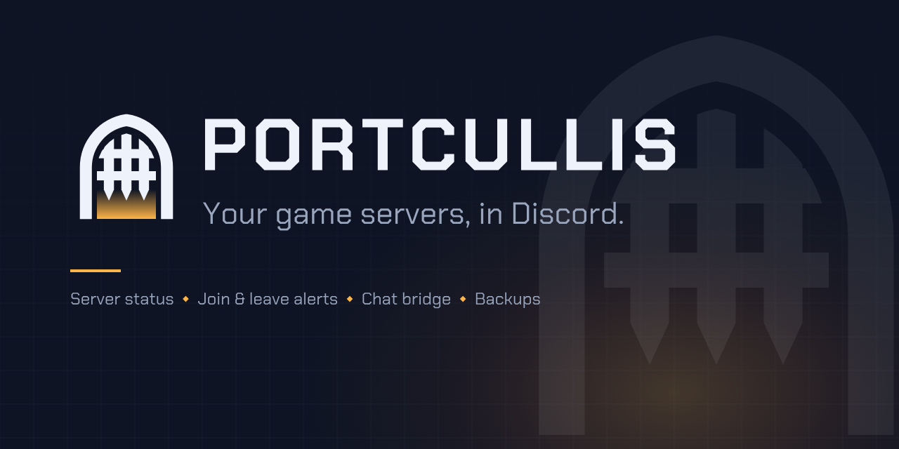
</p>

<p align="center">
  <b>Your game servers, in Discord.</b><br>
  A Discord bot for CubeCoders AMP 3, and the successor to
  <a href="https://github.com/k8thekat/GatekeeperV2">Gatekeeper V2</a> and <a href="https://github.com/MinVT-dev/GatekeeperV3-Beta">Gatekeeper V3</a>.
</p>

<p align="center">
  
  
  
  
</p>

---

Portcullis connects your AMP 3 panel to your Discord server:
- members can see which servers are up, ask to be whitelisted and follow the console;
- operators can start and stop servers and run commands without opening the panel.

Everything the bot does is logged, and every risky action asks first.

Portcullis is built for **AMP 3** only. For AMP 2, use [Gatekeeper V2](https://github.com/k8thekat/GatekeeperV2).

> **Status: preview.** Portcullis is built against the AMP 3 preview: first 3.0.0.6, which expires on 7 December 2026, and since 13 November 2026 the API spec a newer live panel serves. These have been checked on a real panel: login, the live event hub, the server list, power, the console and listing backups. Features not yet checked are labelled in Discord and in the [setup guide](docs/SETUP.md#11-known-gaps).

## Contents

- [What it does](#what-it-does)
- [Screenshots](#screenshots)
- [Coming from Gatekeeper V3](#coming-from-gatekeeper-v3)
- [Quick start](#quick-start)
- [Commands](#commands)
- [Who can do what](#who-can-do-what)
- [Safety and privacy](#safety-and-privacy)
- [How it is built](#how-it-is-built)
- [The AMP 3 client on its own](#the-amp-3-client-on-its-own)
- [Documentation](#documentation)
- [Development](#development)
- [Licence](#licence)

## What it does

**Server control**
- `/server list` and `/server status` show each server's state, players, CPU, memory and uptime.
- **Power:**
  - Start, stop and restart from buttons or with `/server power`.
  - A restart can come with a warning in game chat 5 minutes and 1 minute before, plus a Cancel button.
  - Stopping asks first when players are online.
  - `/server power-all` starts or stops every server, or every server with a given AMP tag.
  - You can let members start a stopped server without letting them stop it.
- **Console:** run commands with `/server send` and read recent output with `/server console`. You can also set up to 5 one-click **quick commands** per server, such as "Save world".

**Live in Discord**
- **Relays** post console output, joins and leaves, state changes and in-game chat into the channels you pick.
- A **live server board**: one message that keeps itself up to date with every server.
- **Server banners**: a picture with a card per server. `/server banner` shows it, and the board can use it too.
- The bot's **profile status** shows something like `2/4 servers online · 5 players`.
- **`/notify`** sends members a direct message when a server they follow comes online.
- A **daily summary**, play-time milestones, and a channel renamed to the player count.

**Community**
- **Whitelist requests** come with Approve and Deny buttons. The member gets a direct message with the decision.
- **Whitelist rules** from Gatekeeper V3:
  - only names the member has proved;
  - donators skip the moderators;
  - donator-only servers;
  - a custom approval message.
- **`/link`** proves an in-game name is yours: you type a code in game chat. Linked members can be approved at once and given a role.
- **Player history** shows last seen, play time and most played, from what the bot has seen.
- **`/player id`** converts Steam IDs between formats, and finds Minecraft UUIDs and names.
- **Polls** with buttons, and **events** with Going and Cancel buttons and a reminder 30 minutes before.

**Moderation**
- Kick, ban and unban through each game's own commands.
- A **watchlist** posts a quiet note when a watched name joins.
- **Name rules** flag joins with unwanted words. They catch look-alike letters such as `4` for `a`.
- **Console rules** per server: hide noisy or private lines from the relay, and block risky command words in `/server send`.

**AMP features**
- **Backups**: list, make, restore and delete.
- **Schedules**: run now, turn on or off, see the run history, and delete.
- **Alerts** for a crash, an unexpected stop, high CPU or memory, an old backup, or AMP being unreachable.
- **Your own alert rules** with `/alert create`: any metric and threshold, its own channel and role, and a mute button.

**Running it**
- **Setup panels** (`/setup server`, `/setup bot`) instead of config files. **Check setup** lists what's missing.
- **Fine-grained access**: give a role one task, such as whitelisting, or all tasks on one server only.
- **Audit log** of every action, including refused attempts. It has search, export, statistics and an optional live channel.
- **`/admin diagnostics`** checks AMP, every server and the bot's AMP permissions.
- `/admin export` and `/admin import` back up and restore all settings.

## Screenshots

These are real captures from a running panel:

<table>
  <tr>
    <td width="50%">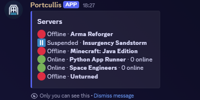<br><sub><code>/server list</code></sub></td>
    <td width="50%">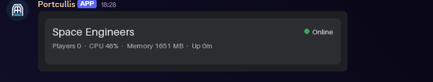<br><sub>A status card for a running server</sub></td>
  </tr>
  <tr>
    <td>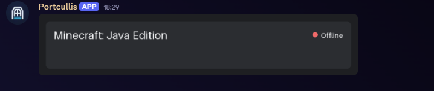<br><sub>The same card when the server is offline</sub></td>
    <td>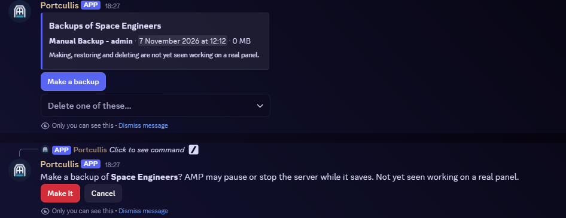<br><sub><code>/backups</code> with the confirm step</sub></td>
  </tr>
  <tr>
    <td>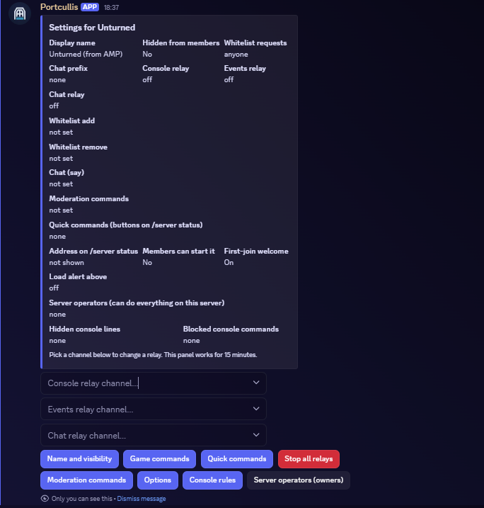<br><sub><code>/setup server</code>, one panel per server</sub></td>
    <td>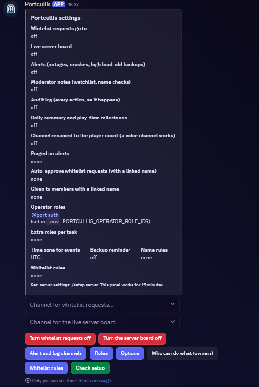<br><sub><code>/setup bot</code> for the settings that cover every server</sub></td>
  </tr>
  <tr>
    <td>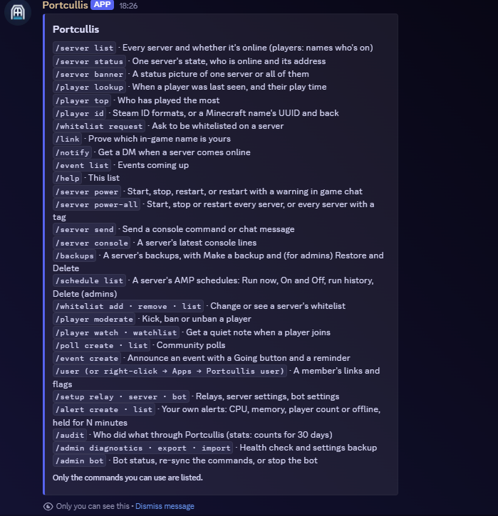<br><sub><code>/help</code> shows only what you may use</sub></td>
    <td>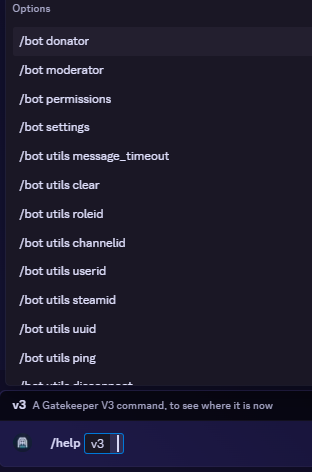<br><sub><code>/help v3:</code> finds where an old V3 command went</sub></td>
  </tr>
  <tr>
    <td>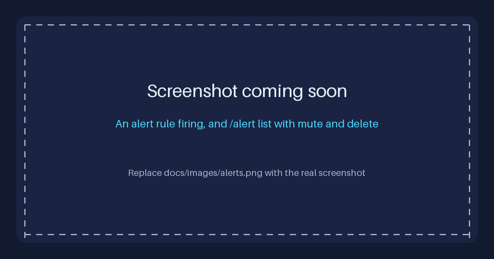<br><sub>Saving an alert rule</sub></td>
    <td></td>
  </tr>
</table>

Still to come (placeholders for now, see [docs/images](docs/images/README.md)):

<table>
  <tr>
    <td width="33%">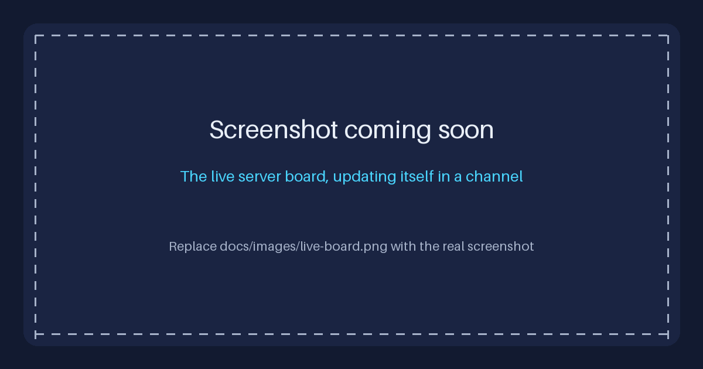<br><sub>The live server board</sub></td>
    <td width="33%">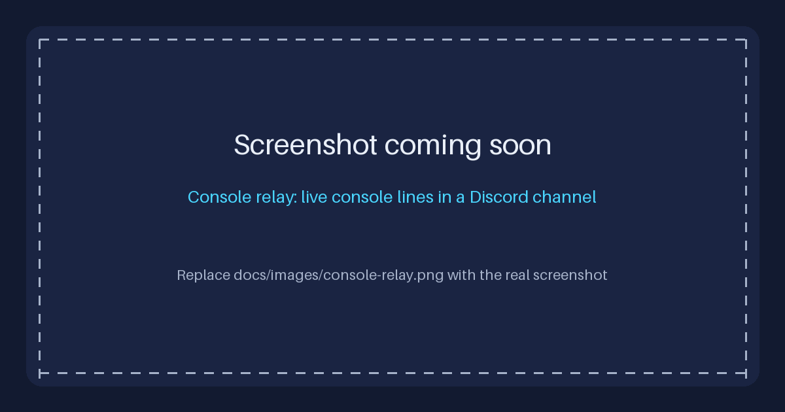<br><sub>Console relay</sub></td>
    <td width="33%">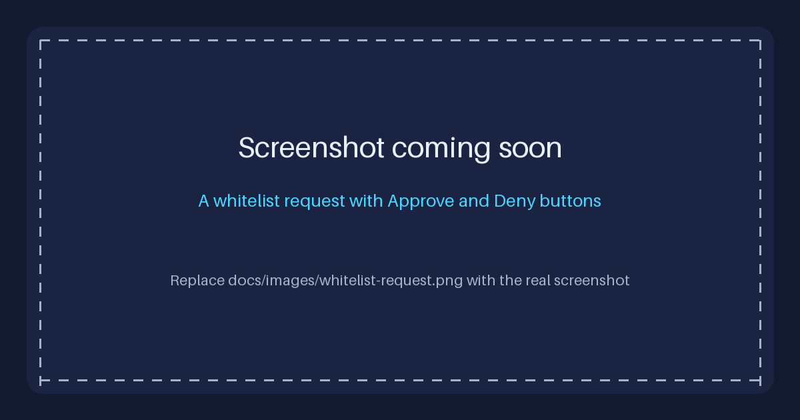<br><sub>A whitelist request</sub></td>
  </tr>
</table>

`/server banner` draws a picture like the one below, in a dark or light theme. This one is real output from the bot, drawn from example data:

<p align="center">
  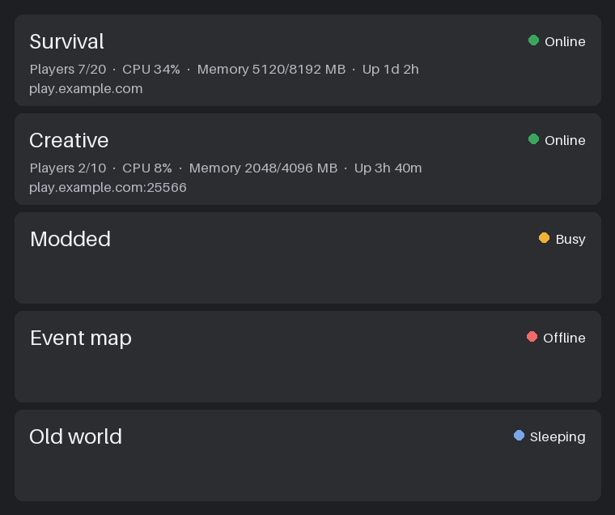
</p>

### The new cards (mock-ups)

These come from the bot's own embed code, drawn with **sample data** by [`tools/render_embeds.py`](tools/render_embeds.py). They are not captures from a real Discord server yet. The game logo is the bot's placeholder.

<table>
  <tr>
    <td width="50%">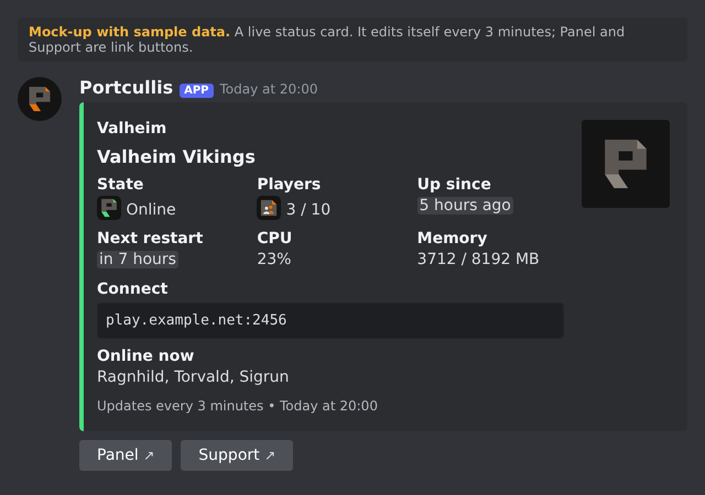<br><sub>A live status card, edited every 2 to 5 minutes</sub></td>
    <td width="50%">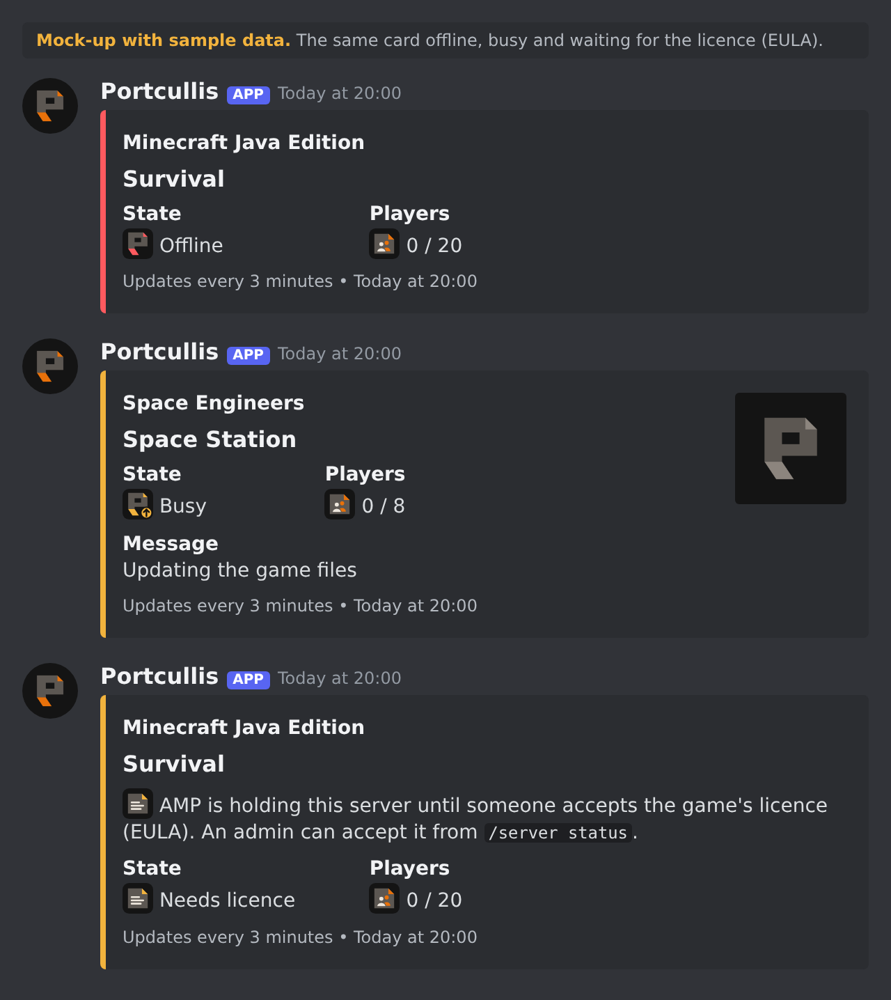<br><sub>Offline, busy, and waiting for the licence (EULA)</sub></td>
  </tr>
  <tr>
    <td>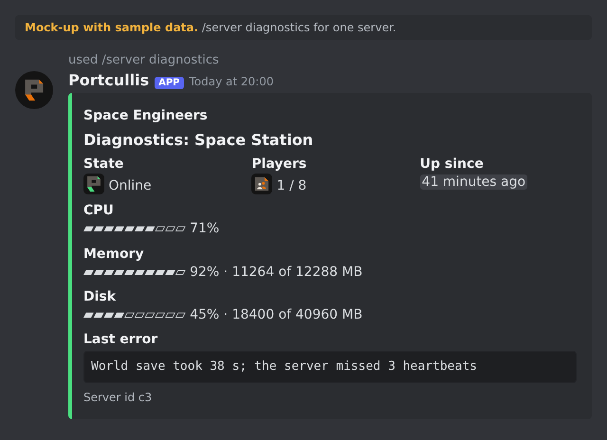<br><sub><code>/server diagnostics</code></sub></td>
    <td>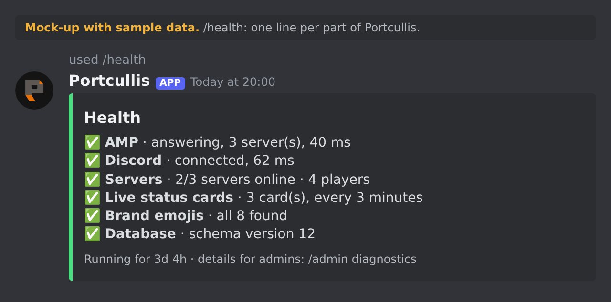<br><sub><code>/health</code></sub></td>
  </tr>
  <tr>
    <td>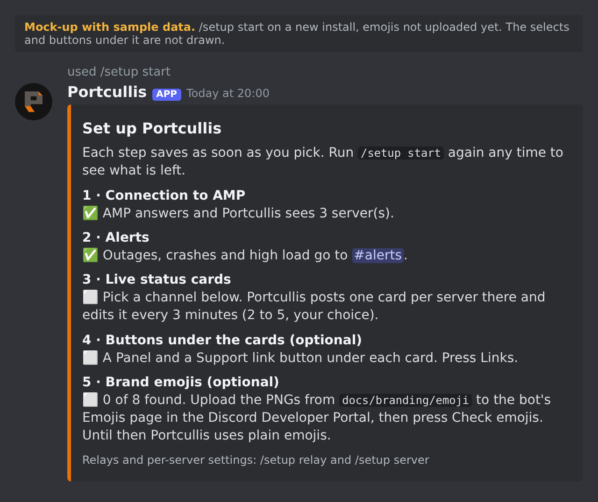<br><sub><code>/setup start</code>, the first-run wizard</sub></td>
    <td>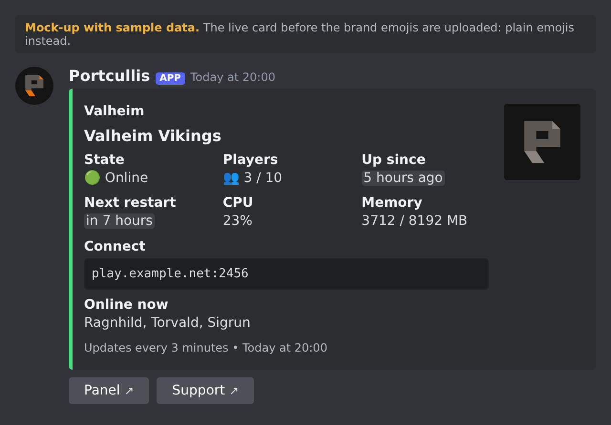<br><sub>Before the brand emojis are uploaded</sub></td>
  </tr>
</table>

## Coming from Gatekeeper V3

Portcullis covers almost all of Gatekeeper V3's 117 commands. Many are grouped differently: there are fewer slash commands, and more buttons and setup panels.

| | Commands |
|---|---|
| Same name | 12 |
| Moved to another command, a button or a panel | 84 |
| Waiting for AMP 3 data that hasn't been seen on a real panel yet | 2 |
| Dropped, each with its reason | 19 |

In Discord, `/help v3:<old command>` tells you where any V3 command went. [V3_PARITY.md](docs/V3_PARITY.md) lists them all.

## Quick start

You need:
- **Python 3.11 or newer**;
- an **AMP 3 panel** that the bot's computer can reach;
- a **Discord application** of your own.

The [setup guide](docs/SETUP.md) walks through every step, with Windows commands first.

```sh
git clone https://github.com/MinVT-dev/Portcullis.git
cd Portcullis
python3 -m venv .venv
.venv/bin/python -m pip install -e ".[dev]"
cp .env.example .env            # then fill it in, see below
.venv/bin/python -m pytest -q   # optional: every test runs against a fake AMP
.venv/bin/python -m portcullis
```

On Windows, use `py -3 -m venv .venv` and `.\.venv\Scripts\python.exe` instead.

**What goes in `.env`:**

| Key | What to put |
|---|---|
| `AMP_URL` | The panel address with its port, as your browser shows it. For example `http://192.168.1.10:8443`. |
| `AMP_USERNAME`, `AMP_PASSWORD` | A **dedicated** AMP user for the bot, without two-factor login. |
| `DISCORD_TOKEN` | Your bot's token from the Discord Developer Portal. |
| `DISCORD_GUILD_ID` | Your Discord server's id. The bot only answers there. |
| `PORTCULLIS_OWNER_IDS` | Your own Discord user id. Owners can do everything. |
| `PORTCULLIS_OPERATOR_ROLE_IDS` | The ids of the roles that may run servers, separated by commas. |

Invite the bot with only **View Channels** and **Send Messages** (`permissions=3072`). It needs no admin rights and no privileged intents.

Then, in Discord:
1. Run **`/setup start`**. It walks through five steps and marks each one done as you go:
   - the connection to AMP;
   - an alerts channel;
   - a channel for the live status cards, and how often they update (every 2 to 5 minutes);
   - optional Panel and Support buttons under the cards;
   - the brand emojis.
2. Optional: upload the eight brand emojis to your application in the Discord Developer Portal. [docs/EMOJIS.md](docs/EMOJIS.md) shows how. Until then the cards use plain emojis.
3. Run `/setup relay` and `/setup server` for the relays and the settings of each server.
4. Run `/health` any time for a one-glance check, or press **Check setup** in `/setup bot`.

## Commands

| Group | Commands |
|---|---|
| Servers | `/server list`, `status`, `power`, `power-all`, `send`, `console`, `banner` |
| AMP | `/backups`, `/schedule list`, `/alert create`, `/alert list` |
| Whitelist | `/whitelist request`, `add`, `remove`, `list` |
| Players | `/link`, `/player lookup`, `top`, `id`, `moderate`, `watch`, `watchlist`, `/user` (also on right-click → Apps) |
| Community | `/notify`, `/poll create`, `/poll list`, `/event create`, `/event list` |
| Setup and admin | `/setup relay`, `/setup server`, `/setup bot`, `/audit`, `/admin diagnostics`, `export`, `import`, `bot` |
| Help | `/help`, `/help v3:` |

[SETUP.md, section 8.4](docs/SETUP.md#84-commands) lists every command with its options and who may use it.

## Who can do what

| Level | Who | For example |
|---|---|---|
| Everyone | Any member of your Discord server | Server status, whitelist requests, `/link`, `/notify`, player lookups |
| Operators | Roles in `PORTCULLIS_OPERATOR_ROLE_IDS` | Power, console, whitelist decisions, moderation, polls and events |
| Admins | Members with **Manage Server** | Setup panels, alert rules, the audit log, and (with an operator role or the backups power too) restoring and deleting backups |
| Owners | Users in `PORTCULLIS_OWNER_IDS` | Everything, plus handing out operator powers and `/admin bot` |

Owners can give a role a single task, such as "may whitelist but not stop servers", or every task on one server only. Discord's own **Integrations** settings can narrow these permissions further, but never widen them.

## Safety and privacy

- **Least privilege.**
  - The bot asks Discord for View Channels and Send Messages only, and no privileged intents.
  - Give it its own AMP user, never your admin account.
- **One Discord server.** Commands are refused anywhere except `DISCORD_GUILD_ID`, so nobody can point your relays at a channel of their own.
- **Nothing pings by accident.**
  - Every message is sent with `@everyone`, `@here`, user and role mentions turned off. The one exception is the role an alert is set to ping.
  - Player names and chat are escaped, so they can't format text or hide links.
- **Confirm before damage.** These actions ask first:
  - stopping a server with players online;
  - restoring a backup (you type the server's name to confirm) or deleting one;
  - deleting a schedule;
  - updating a game;
  - stopping the bot.
- **Everything is audited**, including refused attempts. `/server send` logs only the command word, never its arguments.
- **Secrets stay out of logs and replies.** Error text from AMP is masked the same way before it reaches Discord or the audit log.
  - Passwords, tokens and hub tickets are redacted.
  - `.env`, the database and recordings are ignored by git.
- **Console rules can't freeze the bot.** Patterns that could backtrack badly are refused, and only the first 300 characters of a line are checked.

## How it is built

```
Discord  <->  portcullis/bot   (slash commands, buttons, panels)
                    |
              portcullis/core  (types, live state, relay, rules; knows neither Discord nor AMP)
                    |
              portcullis/amp   (adapter)  ->  portcullis-api (the AMP 3 client)  ->  your AMP 3 panel
                    |
              portcullis/db    (SQLite: settings, audit log, players, whitelist, polls, events, alerts)
```

- **The stack:** Python 3.11+ with asyncio throughout, using discord.py, aiohttp, pydantic v2, aiosqlite and Pillow.
- **The layers stay apart.** Discord code never imports the AMP client, and a test checks this.
- **Live events** come from AMP 3's SignalR hub (`/hubs/shard`). The bot opens one connection per server, because AMP's console lines carry no server id.
- **Schema upgrades** run when the bot starts. The database is copied to a `.bak` file first.
- **Tests** run against a fake AMP built from the API spec and from what was seen on a real panel. More than 190 tests run in about ten seconds.

## The AMP 3 client on its own

The AMP layer is a separate package, [`portcullis-api`](packages/portcullis-api/README.md). You can build your own bot, dashboard or script on it without any Discord code, and it is MIT licensed.

```python
from portcullis_api import AmpClient, Credentials

async with AmpClient("https://panel.example:8443", Credentials("bot", "password")) as amp:
    for shard in await amp.shards.get_shards():
        print(shard.display_name)
```

It covers:
- all 269 operations in the AMP 3 API (the spec a live panel served on 13 November 2026), with typed models;
- file, zip and snapshot downloads through AMP's download tickets;
- a login that renews itself;
- live events;
- a fake panel for your tests.

## Documentation

| Document | What's in it |
|---|---|
| [Setup guide](docs/SETUP.md) | Installing, the AMP bot user, the Discord application, every command and setting, known gaps, troubleshooting |
| [Gatekeeper V3 commands](docs/V3_PARITY.md) | Where each of V3's 117 commands went |
| [Ideas list](docs/IDEAS.md) | Every feature idea and its status |
| [Design](docs/DESIGN.md) | The plan, the decisions and the reasons for them |
| [Developer notes](docs/DEVELOPING.md) | Code layout, conventions, tests and the licence note |
| [portcullis-api](packages/portcullis-api/README.md) | The AMP 3 client on its own |
| [AMP 3 API notes](docs/amp3-api/README.md) | The full API reference, with live results from a real panel |
| [What AMP 2 can run](docs/AMP2_SUPPORTED.md) | Every game template, with its player and chat support |
| [Game art](docs/GAME_ASSETS.md) | Banners and logos for the 229 games AMP can run |
| [Branding](docs/branding/README.md) | The logo, icon, banners, palette and type |
| [Beta checklist](docs/BETA_CHECKLIST.md) | What to check on a real panel before a release |

## Development

```sh
.venv/bin/python -m pip install -e ".[dev]"
.venv/bin/python -m pytest -q
.venv/bin/ruff check .
```

CI runs:
- ruff;
- the tests on Python 3.11 and 3.13;
- `pip-audit`;
- a separate job that builds and tests `portcullis-api` on its own.

`tools/record_events.py` records live events from your own panel, so support for a new game can be built from real data. Read [DEVELOPING.md](docs/DEVELOPING.md) before you change anything.

## Licence

- **The bot** is licensed under the [GNU AGPL-3.0-or-later](LICENSE).
- **The [`portcullis-api`](packages/portcullis-api/) package** is licensed under [MIT](packages/portcullis-api/LICENSE).
- **The pinned AMP API spec and the code generated from it** contain CubeCoders' API descriptions. Those aren't ours to license; see the [licence note](docs/DEVELOPING.md#licence-note).

Portcullis is not affiliated with or endorsed by CubeCoders. "AMP" is CubeCoders' product name.
