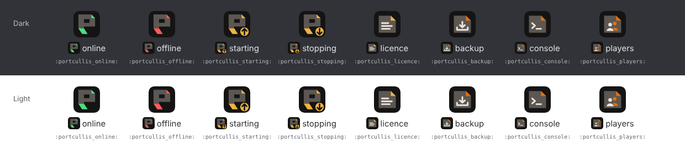

# Brand emojis

Portcullis has its own set of eight emojis. They are in the brand's colours and use the folded p from the logo. They are optional:
- until they are uploaded, Portcullis uses plain emojis such as 🟢 and 👥;
- each one switches over as soon as it is found.

A missing, misnamed or deleted emoji never breaks a card.



| File | Shown for | Plain emoji until it is uploaded |
|---|---|---|
| `portcullis_online.png` | A server that is running (green folds) | 🟢 |
| `portcullis_offline.png` | A server that is stopped (red folds) | 🔴 |
| `portcullis_starting.png` | A server that is starting or busy (mustard folds, up arrow) | 🟡 |
| `portcullis_stopping.png` | A server that is going down (mustard folds, down arrow) | 🟠 |
| `portcullis_licence.png` | A server waiting for someone to accept the game's licence (EULA) | 📜 |
| `portcullis_backup.png` | Backup lines in `/backups` | 💾 |
| `portcullis_console.png` | Console replies | ⌨️ |
| `portcullis_players.png` | Player counts | 👥 |

## Upload them

These are **application emojis**. They belong to the bot itself, not to a Discord server:
- they take none of your server's emoji slots;
- members don't need Nitro to see them;
- they work in every channel the bot posts in.

1. Open the [Discord Developer Portal](https://discord.com/developers/applications) and pick your Portcullis application.
2. Click **Emojis** in the menu on the left.
3. Upload the eight PNGs from [`docs/branding/emoji/`](branding/emoji/). Upload the PNGs, not the SVGs.
4. Keep each name exactly as the file name, without `.png`. For example: `portcullis_online`.
   - Portcullis finds the emojis by name.
   - A renamed emoji counts as missing, and its plain emoji is used instead.
5. In Discord, run `/setup start` and press **Check emojis**. Or wait for the next restart; Portcullis looks the emojis up when it starts.

To check them later, run `/health`. Its **Brand emojis** line shows how many were found. For example:
- `all 8 found`;
- `5 of 8 uploaded, plain emojis for the rest`;
- `couldn't read them from Discord`, if Discord didn't answer. The plain emojis are used until the next check.

## Where they show

They show in card text and field values: State, Players, the licence notice, console replies and backup lists. Discord doesn't draw custom emojis in embed titles, so Portcullis never puts them there.

## Change them

The SVGs are the source.
1. Edit [`docs/branding/emoji.py`](branding/emoji.py).
2. From the repo root, run:

   ```sh
   python3 docs/branding/emoji.py
   node docs/branding/render_emoji.js   # needs Playwright
   ```

   This writes the 128×128 PNGs and `preview.png`.
3. Upload the new PNGs under the same names. Delete the old emojis in the Developer Portal first, because the names must be unique.
4. Press **Check emojis** again. Each emoji gets a new id when it is uploaded again.

To add an emoji, add it in two places:
- in `emoji.py`;
- in `SET` in [`portcullis/bot/emojis.py`](../portcullis/bot/emojis.py), with its plain-emoji fallback.
