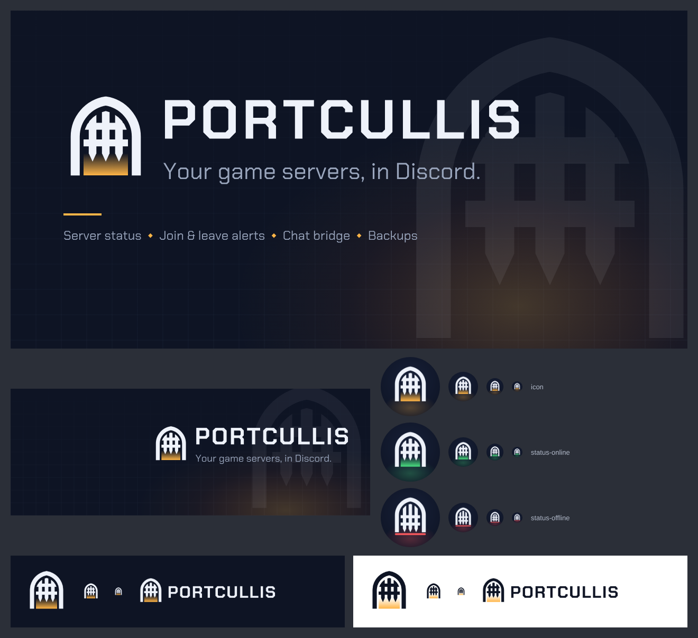

# Portcullis brand

**Decision (Min, 2026-11-07):** the AMP 3 edition of the bot is called **Portcullis**. Gatekeeper V2 and V3 keep their names.

## Idea (v3, 2026-11-13)

The mark is a gate in a pointed arch, with the portcullis hanging half-raised and light coming from under it.

- **It reads as a portcullis.** v2's hexagon arch and three spiked bars read as letters ("AA") at small sizes. v3 draws a real lattice: three bars and two rails, so the grid shape survives at 20 px, and a pointed arch, which says "castle gate" on its own.
- **One warm accent.** Torchlight amber (`#FFB547`) replaces cyan. It gives Portcullis its own colour and keeps clear distance from CubeCoders' palette. There is still no cube, no hexagon badge, and no part of the CubeCoders or AMP logos.
- **Built on a grid.** The mark sits on a 64-unit grid: the arch is 6.5 units thick, the bars 5.5, the rails 5. The gate is clipped to the arch's inside, so frame and gate always read apart.
- **Status is built in.** Gate raised with light under it: amber on the brand icon, green for online. Gate down with the spikes on the ground and a red sill: offline.
- **Wordmark:** `PORTCULLIS` in Chakra Petch Bold, all caps with 6% tracking. Its cut corners echo the gate's spikes.

## Files

SVG is the source. Upload-ready PNGs are in [`png/`](png/).

| File | PNG | Use it for |
|---|---|---|
| [portcullis-icon.svg](portcullis-icon.svg) | 1024×1024, plus `portcullis-avatar-512.png` | Discord app icon and bot avatar. Full-bleed, and the mark stays inside Discord's circle crop. |
| [portcullis-status-online.svg](portcullis-status-online.svg) | 256×256 | Online status in embeds and thumbnails. |
| [portcullis-status-offline.svg](portcullis-status-offline.svg) | 256×256 | Offline status. |
| [portcullis-banner.svg](portcullis-banner.svg) | 1280×640 | GitHub social preview, release posts. |
| [portcullis-discord-banner.svg](portcullis-discord-banner.svg) | 1360×480 | The bot's Discord profile banner (680×240 at 2×). The left third stays plain, because the avatar sits there. |
| [portcullis-logo.svg](portcullis-logo.svg) / [-dark](portcullis-logo-dark.svg) | 264 high | The mark and wordmark together, for dark and light backgrounds. |
| [portcullis-mark.svg](portcullis-mark.svg) / [-dark](portcullis-mark-dark.svg) | 512×512 | The mark on its own, with a transparent background. |
| [portcullis-game-banner.svg](portcullis-game-banner.svg) | 920×430 | Placeholder banner for a game with no art of its own. The PNG is `portcullis/assets/fallback/game-banner.png`; see [GAME_ASSETS.md](../GAME_ASSETS.md). |
| [portcullis-game-logo.svg](portcullis-game-logo.svg) | 512×512 | Placeholder logo for a game with no art of its own (`portcullis/assets/fallback/game-logo.png`). Grey light, so it doesn't read as the bot's own avatar. |

**Rebuild:**

1. `python3 docs/branding/generate.py docs/branding FONT_DIR` rewrites every SVG. It needs `fonttools`. FONT_DIR holds `ChakraPetch-Bold.ttf` and `ChakraPetch-Regular.ttf` from Google Fonts. All text becomes outlines, so the SVGs look the same everywhere and don't need the fonts installed.
2. `node docs/branding/render_png.js` renders every PNG, including the two game fallbacks, with headless Chromium. It needs Playwright.

**Minimum sizes:** the mark holds up down to 16 px. Below 24 px, use the icon (mark on navy), not the bare mark. Keep the wordmark at least 14 px high.

## Palette

| Role | Hex |
|---|---|
| Night (background) | `#0E1424`, lifted `#18213A` |
| Stone (mark and text) | `#EEF2FA` |
| Mist (secondary text) | `#9AA6BD` |
| Lines | `#8FA3C8` at low opacity |
| Torch (brand accent) | `#FFB547`, ember `#FF7A2F` in glows |
| Online / success | `#4ADE80` |
| Offline / error | `#FF5A5F` |

Embed colours in the bot can use the same values: Torch for neutral notices, green and red for status.

## Type

- **Wordmark and text:** Chakra Petch Bold and Regular (SIL Open Font License).

**Tagline:** "Your game servers, in Discord." Keep "AMP" and CubeCoders' logos out of all Portcullis artwork, so nothing suggests it's an official CubeCoders product. Whether "Portcullis for AMP 3" is OK as a descriptive subtitle is a question for Mike.

**History:** v1 (PR #7) was rejected. v2 (PR #10) was the hexagon gatehouse in cyan and Exo 2. v3 replaces both.

## Still to check before going public

- **Trademark search** (EUIPO and USPTO) for "Portcullis" in software classes 9 and 42. Not done yet.
- **Discord app directory:** search for an existing app called Portcullis. Not done yet.
- Known other uses, none of them a Discord bot or game-server tool: Docker's Go secret-redaction library `docker/portcullis`, the PyPI package `portcullis` (an AI-agent policy layer), a bioinformatics tool, a 0★ Discord gateway proxy repo `ShadyDonkey/portcullis`, and Portcullis Games on Steam. The `portcullis` name is taken on both npm and PyPI, so a published package would need another name, such as `portcullis-bot`.

## Rename status

- **Done:** the GitHub repo is now [`MinVT-dev/Portcullis`](https://github.com/MinVT-dev/Portcullis) (renamed by Min, 2026-11-07). The old `gatekeeper-AMP-3` URL redirects.
- **Done in this PR:** every mention of the new bot in the docs now says Portcullis. That covers titles, the package layout `portcullis/`, the "Apps → Portcullis user" context menu, the suggested AMP role, and decision D-2 (closed).
- **Kept on purpose:** Gatekeeper V2, Gatekeeper V3, `GatekeeperV2`, `GatekeeperV3-Beta`, the `gatekeeperv2` AMP template, and lines that describe what V2/V3 did. Those are history.
- **Still to do outside the repo:** the Discord application name, the bot username, the icon and the profile banner in the Developer Portal, and the AMP 3 role and bot user (name both `Portcullis`).
- **Code:** the Python package is `portcullis` from the first commit.
